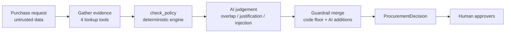
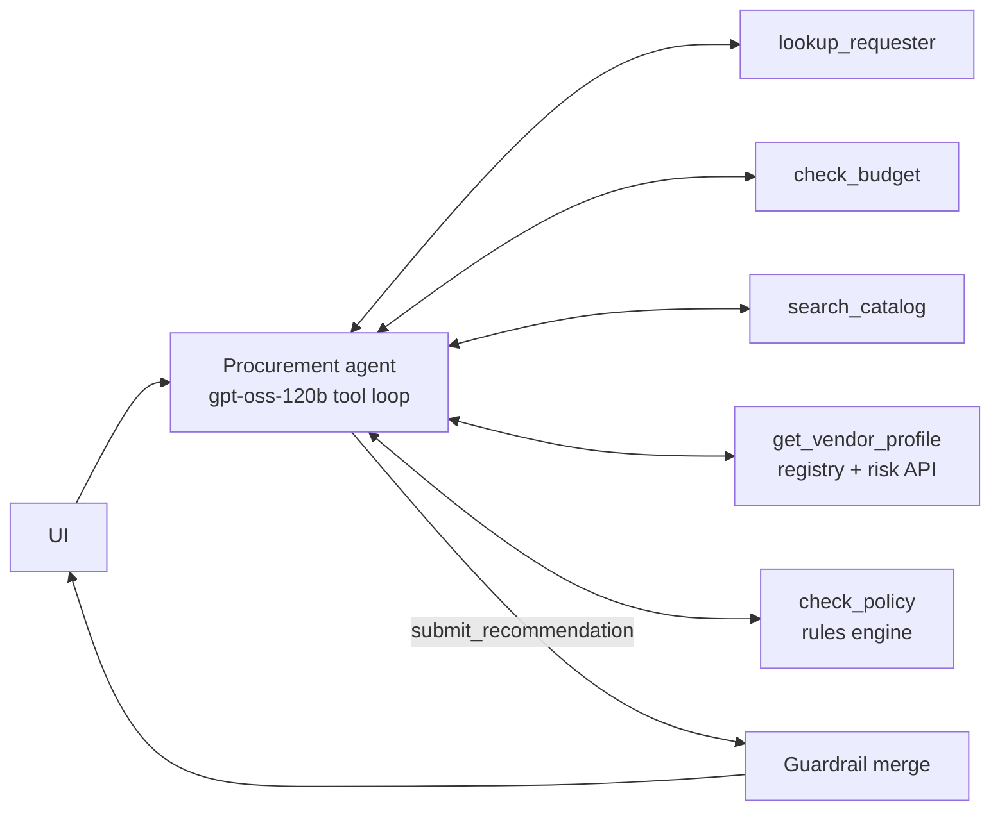
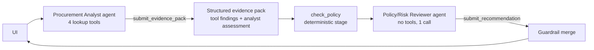

# Architecture, workflow and assumptions

## Responsibility split

| Layer | Owns | Where |
|---|---|---|
| **Code** | Required-field checks, financial thresholds, budget fit, Security / Privacy / Legal triggers, 365-day review currency, registry-vs-API conflicts, pattern-based injection detection, the minimum route, evidence text | `src/facts.py`, `src/policy_engine.py`, `src/tools.py` |
| **AI** | Whether an existing tool or contract already covers the need, whether the justification is credible, injection attempts the patterns miss, choosing a stricter route, rationale and clarifying questions | `src/agents.py` |
| **Human** | Every approval, exception and override. `human_review_required` is always `true` | UI "Human decision" tab |

The **guardrail merge** in `src/copilot.py` enforces that split. Approvals, risk flags and missing information are the policy engine's results plus anything the model adds; the model cannot remove anything. The final route is whichever of the code route and the model route is stricter. Evidence items are built by code from tool outputs, never written by the model. If the LLM fails, the result is the rules-only decision with an `ai_assessment_unavailable` flag.

## Workflow (shared by both architectures)

## Architecture A: single agent (`architecture="single"`)

One agent calls all five tools and then `submit_recommendation`. On Groq, gpt-oss makes one tool call per turn, so a typical run is 6 LLM calls.

## Architecture B: staged, two agents (`architecture="staged"`)

**Handoff format:** the reviewer receives `{untrusted_request, tool_findings[], analyst_assessment, policy_engine}` as JSON. It has no data tools, so it can only reason over evidence that has already been grounded.

## Tools

| Tool | Deterministic | Source |
|---|---|---|
| `lookup_requester(employee_id)` | yes | employees.csv |
| `check_budget(employee_id, annual_cost_usd)` | yes | employees.csv + department_budgets.csv |
| `search_catalog(product, vendor, category)` | yes | software_catalog.csv + purchase_history.csv |
| `get_vendor_profile(vendor_name)` | yes | vendors.csv + mock vendor-risk API (handles 404, 503 and timeouts) |
| `check_policy()` | yes (rules engine) | procurement_policy.md, encoded in `src/policy_engine.py` |
| `submit_recommendation` / `submit_evidence_pack` | structured output | model |

## Stop and escalation conditions

| Condition | Route |
|---|---|
| Missing cost, users, data level, requester, product or purpose; or a justification that isn't credible | `REQUEST_CLARIFICATION` |
| Vendor-risk API unavailable, registry and API in conflict, or budget can't be found | `ESCALATE_MANUAL_REVIEW` |
| Existing tool appears to cover the need, with no credible gap (AI judgement) | `CONSIDER_EXISTING_TOOL` |
| Security, Privacy or Legal triggered, or budget shortfall | `ROUTE_FOR_SPECIALIST_REVIEW` |
| Otherwise | `ROUTE_FOR_BUSINESS_APPROVAL` |

The agent loop stops after `submit_*`, or after 8 turns. Once every evidence tool has been called, the submit tool is forced. On Groq, `tool_choice` validates the model's output but doesn't constrain it, so the loop recovers in both directions: if prose is rejected, it forces submit on the next turn; if a forced submit is rejected because the model wanted another tool, it gives the model one free turn. Each LLM request takes the next key from a round-robin pool (`GROQ_API_KEYS`). A rate-limited or rejected key is rested for its `retry-after` period and the request moves to the next key; the run only waits when every key is resting. Malformed tool calls are retried twice. Any other LLM error falls back to the rules-only decision.

## Assumptions

- The reference date is parsed from `procurement_policy.md` (2026-09-30), never taken from the system clock.
- A requester's department comes from `employees.csv`. Its budget is the matching row in `department_budgets.csv`.
- A "new vendor" is one that is missing from the registry or has a procurement status other than `Approved`.
- A security assessment is current only when it is approved, no more than 365 days old, consistent between the registry and the API, and the API is reachable.
- An unknown data-access level or unknown spend is treated conservatively: Security is added, and Legal is added for new vendors, until clarified.
- Same-category tools from other vendors are flagged as overlap by code. Whether a same-vendor contract already covers the need is left to the AI.
- An `SSO` integration alone does not trigger Security review. Production, cloud, git or source-code, credentials and secrets do.
- Cross-region processing of PII triggers Privacy and Legal review (policy sections 6 and 7).

## Not built, on purpose

- No framework or third agent. Plain OpenAI-SDK tool loops are easy to audit.
- No persistence for the human decision log; it lives in the session only.
- No RAG over the policy. It is short, and it is encoded as rules.
